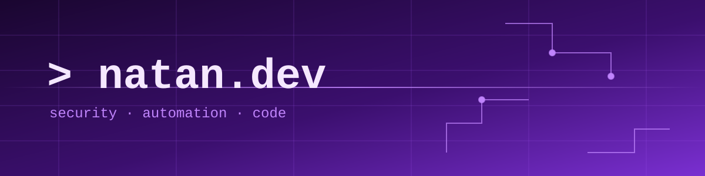

  

# Natan

Explorando inteligência artificial na prática: da experimentação com modelos de linguagem à construção de pequenos sistemas que resolvem problemas reais. Interesse em automação, segurança da informação e tecnologia aplicada ao dia a dia.

## Interesses

- **Inteligência artificial:** modelos de linguagem, automação com IA e uso prático de ferramentas generativas.
- **Automação:** fluxos de atendimento e agendamento integrados ao WhatsApp.
- **Segurança da informação:** boas práticas e curiosidade por como sistemas são protegidos e por onde falham.
- **Desenvolvimento:** aprendizado contínuo em programação, com projetos em Python e PostgreSQL.

## Projetos

| Projeto | Descrição |
|---|---|
| [chatbot-barbearia](https://github.com/NatanLopesGimenez/chatbot-barbearia) | Chatbot de agendamento e atendimento automatizado via WhatsApp |

## Contato

Quer trocar ideias sobre IA, automação ou projetos? Abre uma issue neste repositório ou me chama pelo perfil.
